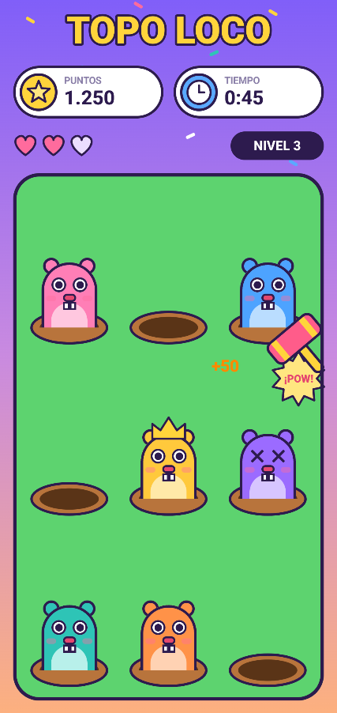

# Topo Loco

Maqueta de un minijuego de golpear topos, hecha con **Jetpack Compose**.
Es solo la pantalla del juego (diseño), sin lógica de juego: los datos del tablero están escritos en el código.

  

## Qué se ve en la pantalla

- **Título** «TOPO LOCO» con contorno.
- **Marcadores** de puntos y tiempo, con iconos dibujados (estrella y reloj).
- **Vidas** con corazones llenos y vacíos, y el **nivel** actual.
- **Tablero** de 3 × 3 agujeros con topos de seis colores: uno con **corona** y otro **aturdido** (ojos en X y efecto de golpe).
- **Martillo**, **confeti** y fondo con **degradado**.

## Cómo está hecho

Todo está dibujado con código, sin imágenes:

- **Maquetación:** `Column`, `Row`, `Box`, `Spacer` y `Modifier` (`weight`, `offset`, `padding`, `align`…).
- **Formas:** `CircleShape` y `RoundedCornerShape` para orejas, ojos, nariz, cuerpo y barriga de los topos, y para los marcadores.
- **Canvas:** para lo que no es un círculo ni un rectángulo: agujeros (`drawOval`, `drawArc`), ojos aturdidos (`drawLine`), estrella, corazones, corona, martillo y confeti (`Path`).
- **Capas:** cada agujero tiene una parte de atrás, el topo y una parte de delante que lo tapa, para que parezca que sale del hoyo.
- **Datos del tablero:** una lista de `Celda` (con o sin topo, corona o golpe) que el tablero reparte en filas de 3 con `chunked(3)`.
- **Composables pequeños y reutilizables:** `Topo`, `Oreja`, `Ojo`, `Diente`, `Agujero`, `Marcador`, `Corazon`…

## Paleta

| Uso | Color |
|-----|-------|
| Fondo (degradado) | `#7C5CFA` → `#C98AE0` → `#FFB27A` |
| Tablero | `#5DD36F` |
| Tierra / hoyo | `#B8743C` / `#5A3417` |
| Contornos y texto | `#2D1B4E` |
| Topos | rosa, azul, amarillo, morado, turquesa y naranja |

## Tecnologías

- Kotlin + Jetpack Compose
- Material 3
- Android Studio · minSdk 26
- Diseño previo en Figma